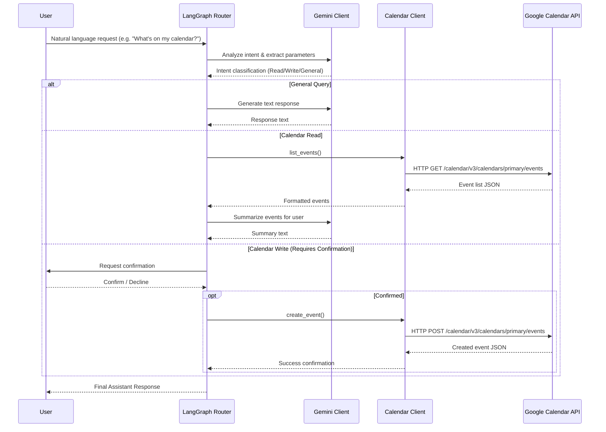

# Data Flow

This document details how requests are processed and data flows through the My Agent system.

## Request Lifecycle

## State Management
- Conversation state and context are tracked via LangGraph nodes.
- OAuth tokens (`token.json`) are securely loaded locally per session.
